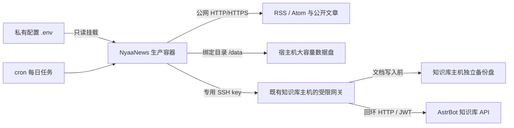
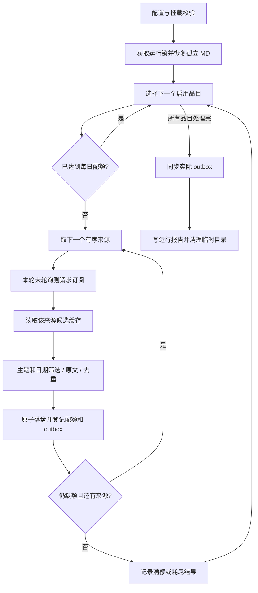
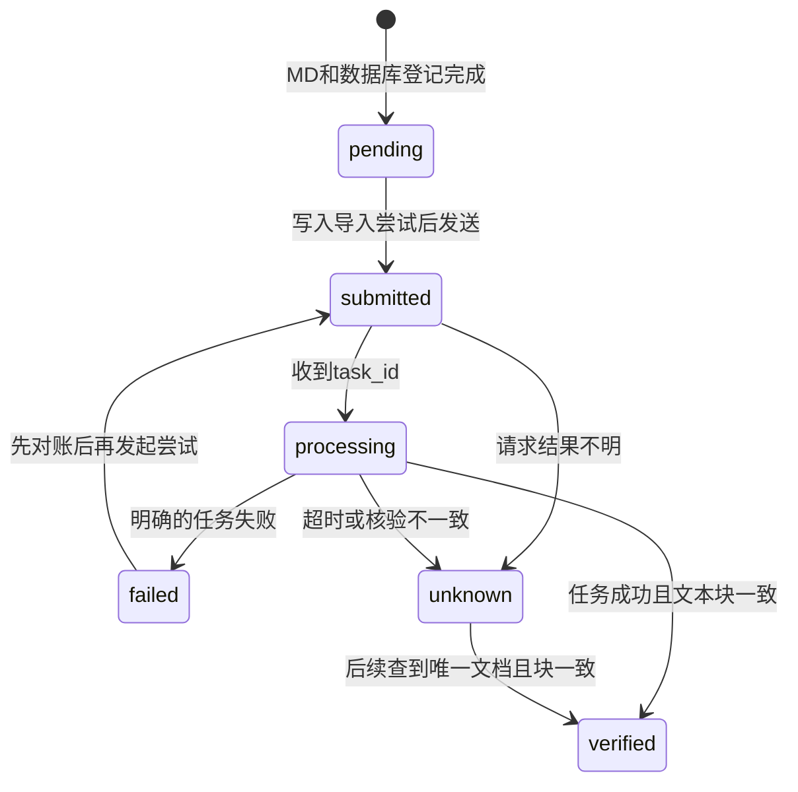

# 技术文档：NyaaNews 猫猫报纸

> 部署修订（2026-11-01）：生产采集器迁至 macmini，Windows 容器停用。本篇原 0.2.0 业务算法说明仍适用；部署构建以本文修订及 [生产部署说明](生产部署-macmini.md) 为准。

本文说明猫猫报纸的业务使用方法、完整工程结构、配置和数据契约、每日采集与知识库同步流程、Docker 生产部署方式，以及从项目实践中提炼的设计方法。主要读者是项目维护者、部署者和接续开发者。

## 文档范围与状态

本文以 **2026-10-26、版本 0.2.0** 的源码为基线，功能实现基线提交为 `8ec636f`。覆盖范围参照 NyaaRink 技术文档的“操作流程 → 产品能力 → 工程与生命周期 → 数据和凭据 → 运维与验收 → 可复用设计”组织，并按新闻采集项目的实际职责展开。

NyaaNews 是运行于 Docker 的 Python 定时批处理程序。RSS/Atom 用于发现候选，程序抓取公开网页并抽取原语言正文，保存 Markdown，再通过既有 AstrBot 的知识库接口同步。当前没有 Web GUI、对外 REST 服务或 MCP 服务，也不在生产采集链路中调用大模型。

本项目采集器自 2026-11-01 起部署在 macmini Docker；本机负责开发、构建和推送。外部 AstrBot 维持其既有部署；放置在知识库主机上的 SSH 网关是 API 接入与备份辅助程序，不执行新闻发现、抓取或定时采集。

开发状态的唯一事实来源仍是 [开发计划 SSOT](开发计划-SSOT.md)。本文提供架构解释与实现参考；具体维护步骤见 [运维说明](运维说明.md)，本轮交付证据见 [阶段交接 007](阶段交接-007.md)。后续版本改变代码时，应同步更新本文，不能把历史验证结果当作新的实测结论。

实际品目、订阅地址、目标知识库名称、凭据及部署网络配置保存在被忽略的 `.env/`；本文仅使用通用示例。`.ref/` 保存原始参考资料和私有来源研究记录，不随开源仓库发布。

## 术语与职责边界

| 名称 | 含义 |
| --- | --- |
| 品目 / 主题（topic） | 一个独立的每日采录配额与分类目标，由 `topics.json` 定义。 |
| 来源（source） | 一个具有稳定 ID 的订阅入口，包含请求方式、主题映射和筛选规则。 |
| 候选（candidate） | 从 RSS/Atom 解析出的链接、标题、时间等发现信息；尚不等于取得原文。 |
| 正式文章（article） | 已通过时间核验、正文提取、去重和配额检查，并落成 Markdown、登记数据库的文章。 |
| 目标日（target date） | 本轮要采录的原文发布日期范围，默认是配置时区下的前一自然日。 |
| 每日配额（allocation） | 文章在某个目标日、某个主品目中占用的一个名额，重跑不会重置。 |
| 待同步队列（outbox） | SQLite 中对知识库导入工作的持久记录，与 Markdown 和文章表关联。 |
| 已核验（verified） | 远端文档存在且全部文本块与本地预期一致；不是仅获得 HTTP 200 或 task_id。 |
| 网关（gateway） | 由 SSH forced-command 启动的受限程序，转发允许的 AstrBot API，并在文档写入前备份。 |
| 配额不足 / 请求失败 | 前者可以是正常业务结果，后者必须保留错误证据，两者分别记录。 |

网页和 RSS 文本是被处理的数据，不能作为本机命令或配置执行。操作者维护的 `.env/` 是受信配置；来源提供的标题、摘要和正文不是授权信息。程序采用固定逻辑处理新闻，没有让网页文本驱动 Agent 执行命令的路径。

## 一、业务目标与日常使用

### 1. 每日任务的成功条件

当前私有配置包含 11 个品目，每类最多 3 篇，理论总上限为 33 篇。每品目配置 3～5 个有序来源；跨品目共用的订阅去重后，目前共启用 33 个不同来源。

每日任务按如下规则运行：

1. 默认北京时间 08:00 开始，采集前一自然日。
2. 对仍有缺额的品目，依次取用其 `source_order` 中的来源。
3. 每个来源完成发现、日期和主题筛选、原文获取及去重后，才决定是否需要后续来源。
4. 一个品目满额后，停止为它请求剩余来源与候选正文。
5. 全部品目满额后不再发出新闻来源请求；随后仍处理知识库同步。
6. 来源全部用尽仍不足时，按实际数量完成归档与入库，不放宽日期、不采无关内容、不用旧文填数。

因此，`completed` 表示本轮流程正常结束，并不保证采到了 33 篇。是否达到目标数量看 `remaining_count`；是否有来源、正文或同步错误看 `errors`、来源状态和 `sync`。

### 2. 文档内容与知识库用途

每篇文章保存独立 Markdown，包含原标题、原文正文、来源网址、发布时间、抓取时间和可追溯元数据。正文保持原语言，不翻译、不摘要、不由模型补写。

“原文归档”指从网页提取出的正文 Markdown，并非整站 HTML 镜像：菜单、评论和部分页面装饰会被移除；提取器保留文本、链接、表格和格式，并补充文章图注。当前不下载图片、附件或视频，也不执行页面 JavaScript。

AstrBot 收到的是带有标题、发布时间和来源链接的预切块文本。NyaaNews 负责采集和同步；后续聊天问答、检索策略、Embedding 模型和重排模型由既有 AstrBot 配置负责。本项目没有单独提供 AstrBot 聊天插件。

### 3. 命令行入口

容器内模块搜索路径已经配置好，可以直接使用：

```console
docker exec nyaanews python -m nyaanews.cli check
docker exec nyaanews python -m nyaanews.cli status
docker exec nyaanews python -m nyaanews.cli run
docker exec nyaanews python -m nyaanews.cli run --date 2026-10-25
docker exec nyaanews python -m nyaanews.cli run --date 2026-10-25 --no-sync
docker exec nyaanews python -m nyaanews.cli sync
```

| 命令 | 实际行为与边界 |
| --- | --- |
| `check` | 加载配置、校验数据目录并输出版本、启用主题数、启用源数、时区和数据目录；不会探测所有外部连接。目录准备可能创建缺失的子目录。 |
| `discover [--refresh]` | 轮询所有启用来源并写入候选缓存，不执行逐品目配额停取，也不保存新闻正文。它是诊断入口，不是生产 cron 的命令。 |
| `run [--date YYYY-MM-DD]` | 运行有序补足流程；未指定日期则取配置时区下的昨天。 |
| `run --no-sync` | 归档并登记 outbox，暂不调用知识库。 |
| `run --refresh` | 请求订阅时不发送已有 ETag/Last-Modified 条件头；不清空候选、不绕过退避、不重置额度。 |
| `sync` | 处理全部非 verified 的 outbox，不限于最近一个目标日。显式调用会尝试同步，不以 `SYNC_ENABLED` 为开关。 |
| `status` | 输出文章总数及 outbox 按状态的数量。当前通过 `Store` 打开数据库，会先备份并执行建表检查，不应当作严格无写入的诊断命令。 |

全局参数 `--config` 放在子命令之前，例如 `python -m nyaanews.cli --config <配置文件> check`。默认配置路径来自进程的 `NYAANEWS_CONFIG`，否则为 `.env/runtime.env`。

正常返回码为 `0`，部分来源/正文/同步失败为 `2`，命令无法完成的异常为 `1`；参数解析错误由 argparse 返回错误码。CLI 末尾输出 JSON，批处理过程中还会输出逐来源进度 JSON，使用脚本读取时不要假定 stdout 只有一行。

### 4. 补采、重跑与同步重试

手动补采使用明确的 `--date`。重复运行同一天会读取已有配额，满额品目不再发来源请求；已有 URL、canonical 或相同正文不会重复落盘。历史文章修改不会自动创建新版本。

候选缓存可能有助于补采，但 RSS 只返回站点当前暴露的列表。程序尚未提供历史分页、历史归档查询或日内预轮询；关机期间从未进入缓存的新闻不保证能补回。

同步结果未知时，使用 `sync` 触发对账。不要为了消除 `unknown` 而直接把状态改回 `pending`：远端可能已经接受原请求，此时重发会制造重复文档。

## 二、工程结构与部署拓扑

### 1. 目录与模块

```text
NyaaNews/
├── AGENTS.md                         # 项目维护约定
├── README.md                         # 快速入口
├── LICENSE                           # MIT 代码许可证
├── pyproject.toml                    # 包信息、依赖和 CLI 声明
├── requirements.lock                 # 运行依赖版本与哈希
├── Dockerfile
├── docker-compose.publish.yml        # 生产镜像部署
├── restart.py                        # 生产存储预检、拉取、重启、健康核验
├── docker-compose.yml
├── rebuild.py                        # 构建推送；--skip-push 仅本机构建
├── .gitignore / .dockerignore
├── config/                           # 无私人内容的配置示例
├── src/nyaanews/
│   ├── __init__.py                   # 版本和运行标记
│   ├── cli.py                        # 命令路由、退出码、JSON 输出
│   ├── config.py                     # 配置解析、校验、来源顺序
│   ├── feeds.py                      # RSS/Atom 发现、条件请求与退避
│   ├── network.py                    # 受限公网 HTTP 请求
│   ├── extract.py                    # 元信息、正文和 Markdown
│   ├── pipeline.py                   # 日批处理、有序补足与恢复
│   ├── store.py                      # SQLite 事务、备份、配额与队列
│   ├── sync.py                       # AstrBot API、导入与对账
│   ├── ssh_proxy.py                  # 可选 SOCKS5 的 SSH 字节传输
│   └── util.py                       # 时间、URL、哈希、原子写入
├── ops/
│   ├── container.py                  # cron 引导、tick、健康检查
│   └── kb_gateway.py                 # 既有知识库主机上的受限入口
├── tests/                            # 离线回归与合成场景
├── .docs/                            # 设计、SSOT、交接、技术与运维文档
├── .env/                             # 私有配置和专用 SSH 文件；不入 Git
└── .ref/                             # 私有原始参考与研究记录；不入 Git
```

`pyproject.toml` 声明 `nyaanews = nyaanews.cli:main` 包入口。当前 Dockerfile 安装的是依赖锁文件，并通过 `PYTHONPATH=/app/src` 使用源码；容器操作统一采用 `python -m nyaanews.cli`，不依赖额外安装项目包后才生成的可执行入口。

### 2. 技术栈及职责

| 组件 | 职责 |
| --- | --- |
| Python 3.12 容器 / 项目要求 Python ≥3.12 | 批处理、脚本、标准库 SQLite 与时间处理。实际验证基线为 Python 3.12。 |
| feedparser | 解析 RSS/Atom、链接关系和日期字段。 |
| urllib3 | 默认 HTTP 客户端，固定已校验 IP、原主机 SNI 和证书验证。 |
| curl-cffi | 按来源启用的浏览器兼容 HTTP/TLS 模式；不是 Chromium 浏览器，也不执行 JavaScript。 |
| BeautifulSoup、Trafilatura | 页面元数据、标题、图注与原语言正文 Markdown 提取。 |
| python-dotenv、JSON、PyYAML | 私有运行配置、来源/主题配置与 Markdown frontmatter。 |
| SQLite、filelock | 持久状态、备份事务、配额和单批次文件锁。 |
| OpenSSH、可选 SOCKS5 | 到受限知识库网关的认证传输。 |
| cron、tini | 容器内日调度和进程生命周期管理。 |

精确依赖版本由 `pyproject.toml` 与 `requirements.lock` 共同记录；构建使用 `pip install --require-hashes`。基础镜像当前使用 `python:3.12-slim-bookworm` 标签，没有在 Dockerfile 中固定 digest；不能据依赖锁声称整个镜像是完全可复现构建。

### 3. 部署拓扑



开发与生产 Compose 均只有一个 `nyaanews` 服务，不发布 HTTP 端口，不挂载 Docker socket。新闻正文网络访问只允许公网目标；知识库访问走单独配置的 SSH 连接，两条网络路径职责不同。

需要代理时，SSH 可以通过配置的 SOCKS5 入口连接，仍校验目标 SSH 主机密钥。这个配置不用于新闻 HTTP 请求。历史本机部署使用宿主机代理；生产配置关闭此代理，使用直接 SSH 连接。

### 4. 存储与运行目录

生产数据根目录为 macmini 的 `/root/DockerContainer/DockerRes/NyaaNews`，Compose 从 `HOST_DATA_DIR` 读取并绑定为 `/data`。数据库备份独立挂载到统一备份目录；本地 `E:/DockerRes/NyaaNews` 保留迁移前副本。

| 目录 / 文件 | 内容与生命周期 |
| --- | --- |
| `/data/news/YYYY/MM/DD/<topic>/<article-id>.md` | 正式原文归档，长期保留。 |
| `/data/state/nyaanews.db` | 业务状态权威；不写入镜像。 |
| `/data/state/run.lock` | 当前数据根目录的批处理互斥锁。 |
| `/data/state/last-run.json` | 最近一轮归档结果；后续批次覆盖。 |
| `/data/state/scheduler.json` | 最近一次 tick 子进程结束时间和退出码。 |
| `/data/state/container.json` | 容器启动时间、时区和 cron 配置。 |
| `/data/logs/<day>-<run-id>.json` | 各轮详细报告，长期保留且当前不自动轮转。 |
| `/data/backups/` | 本地数据库写前快照及维护保护副本，不自动清理。 |
| `/data/pending/` | 保留的运维目录；正式导入队列位于 SQLite 的 outbox。 |
| `/run/nyaanews-config/` | `.env/` 的只读挂载，包含配置和专用 SSH 文件。 |
| `/tmp/nyaanews/run-*/` | 批次临时目录；正常退出清理，下一批持锁后回收遗留目录。 |
| `/tmp/nyaanews-ssh/id_ed25519` | 专用 key 的运行副本，权限 0600，在 tmpfs 中随容器生命周期存在。 |

网页响应通常在内存中解析，不持续保存完整 HTML 下载缓存。Markdown 的原子写入临时文件位于目标文件同目录，写入完成后替换为正式文件；不能把“任务临时目录清理”理解为已实现所有断电残留文件的全盘扫描。

## 三、配置契约与来源管理

### 1. 配置读取顺序

`Config.load()` 读取 `runtime.env`，关闭 dotenv 变量插值。`TOPICS_FILE`、`SOURCES_FILE` 相对于该文件所在目录解析；JSON 支持 UTF-8 BOM。

CLI 先根据 `--config` / `NYAANEWS_CONFIG` 选择配置文件。进入 `Config.load()` 后，只有 `DATA_DIR`、`NYAANEWS_CONFIG`、`REQUIRE_MOUNT` 被进程环境中的非空值覆盖。其他设置使用私有文件中的值，不能假定任意 `docker exec -e` 都会改变业务设置。

`DATA_DIR` 必须已存在；要求挂载时还必须通过 `os.path.ismount()`。随后准备 `news/state/logs/pending/backups` 子目录。配置校验是程序内的明确检查，不是完整的 JSON Schema 引擎。

### 2. 运行配置参考

| 字段 | 默认 / 要求 | 用途 |
| --- | --- | --- |
| `TZ` | `Asia/Shanghai` | 目标日边界及容器时区。 |
| `DAILY_CRON` | `0 8 * * *` | 容器启动时生成的五段 cron 表达式。 |
| `DATA_DIR` | 必填 | Python 数据根目录；容器强制 `/data`。 |
| `HOST_DATA_DIR` | Compose 必填 | 宿主机绑定目录；应用逻辑本身不使用它。 |
| `REQUIRE_MOUNT` | 值为 `1` 时强制检查 | 容器 Compose 与 cron 都设置为 `1`。 |
| `TOPICS_FILE` / `SOURCES_FILE` | `topics.json` / `sources.json` | 私有配置文件名。 |
| `RUN_BUDGET_SECONDS` | `2400` | 来源和候选循环的时间预算；不是包括同步在内的严格总执行期限。 |
| `SYNC_ENABLED` | `1` 才开启自动同步 | 控制 `run` 末尾是否同步；公共示例为 `0`。 |
| `CHUNK_CHAR_LIMIT` | `900` | 每个预切块的字符预算，包含标题/时间/来源头；不是 token 数。 |
| `GATEWAY_HOST/PORT/USER` | 地址/用户必填，端口默认 `22` | SSH 目标。 |
| `GATEWAY_KEY` / `GATEWAY_KNOWN_HOSTS` | 宿主机路径 | 容器内改用约定的 tmpfs key 和只读 known_hosts。 |
| `GATEWAY_SOCKS_HOST/PORT` | host 为空禁用，端口默认 `1080` | SSH 的可选 SOCKS5 传输。 |
| `GATEWAY_SOCKS_CONTAINER_ONLY` | 值为 `1` 时只在容器使用 | 默认示例为 `1`。 |
| `ASTRBOT_USERNAME/PASSWORD` | 同步时必填 | 登录取得 JWT；JWT 只保留在进程内。 |
| `ASTRBOT_KB_NAME` | 同步时必填 | 按名称唯一匹配目标库，匹配零个或多个则失败。 |

历史 API 配置迁移到私有目录后，根目录 `api.txt` 已删除。生产代码不读取历史 LLM 配置字段。

### 3. 品目与来源的通用示例

以下是假设性示例，不含当前用户的真实订阅。`enabled=false` 避免示例地址被当作可用来源。

```json
{
  "topics": [
    {
      "id": "sample",
      "name": "Example topic",
      "enabled": true,
      "max_articles_per_day": 3,
      "source_order": ["primary", "secondary", "reserve"]
    }
  ]
}
```

```json
{
  "sources": [
    {
      "id": "primary",
      "feed_url": "https://primary.example.invalid/feed.xml",
      "topics": ["sample"],
      "enabled": false,
      "feed_http_profile": "standard",
      "article_http_profile": "standard",
      "topic_rules": {
        "sample": {
          "include": ["research|release"],
          "exclude": ["sponsored"],
          "title_include": [],
          "title_exclude": ["weekly roundup"]
        }
      }
    },
    {
      "id": "secondary",
      "feed_url": "https://secondary.example.invalid/feed.xml",
      "topics": ["sample"],
      "enabled": false
    },
    {
      "id": "reserve",
      "feed_url": "https://reserve.example.invalid/feed.xml",
      "topics": ["sample"],
      "enabled": false
    }
  ]
}
```

ID 使用小写字母起始，后续允许小写字母、数字、下划线和连字符，长度不超过 64。每日额度默认 3，程序允许整数 0～50；“11 类、每类 3 篇、每类 3～5 来源”属于当前业务配置，未硬编码成通用引擎的固定限制。

显式 `source_order` 必须没有重复 ID、只引用存在且声明服务该品目的来源。运行时忽略禁用来源；没有列入 order 的来源不为该品目取用。旧配置未提供 order 时，按来源 `weight` 降序处理，同权重保持来源配置顺序。

品目本身按 `topics` 数组顺序执行。这一顺序也决定跨品目重复文章的主分类优先级；系统没有全局最优分配算法，不会把已归档文章移动到其他缺额品目。

### 4. 筛选规则及有效字段

来源全局规则和该品目的 `topic_rules` 必须同时通过。每组规则内部：非空 include 至少命中一个，exclude 不能命中；title_include/title_exclude 仅检查 RSS 候选标题。匹配使用忽略大小写的 Python 正则。

| 来源字段 | 当前实现行为 |
| --- | --- |
| `feed_url`、`topics`、`enabled` | 订阅入口、服务品目与启用状态。 |
| `feed_http_profile` / `article_http_profile` | `standard` 或 `chrome`，分别控制订阅与原文请求。 |
| `include/exclude/title_include/title_exclude` | 来源通用规则。 |
| `topic_rules` | 为共享来源定义品目独立规则。 |
| `weight` | 仅在品目未提供 source_order 时用于来源优先级。 |
| `community` | 为真时，禁止用社区提交时间替代原文发布时间。 |
| `source_timezone` | 页面日期包含时间但没有时区时，可用明确配置时区解释。 |
| `min_body_chars` | 正文长度下限，默认 400。 |
| `name`、`verified_on` 等记录字段 | 供维护者阅读，不自动改变采集逻辑。 |

当前没有语言白名单、重要性语义评分、新闻事件聚类或正文关键词二次分类；提取的 `language` 只是 HTML 的 lang 记录。早期草案中的 `max_age`、`allow_full_text`、`requires_browser` 等不能当作已实现的开关。

### 5. 新增或调整来源的方法

先验证订阅能解析出标题、链接和日期，再验证至少一篇原文可抓取和提取。公开订阅返回 200，不等于原文正文路径也可用。

验证后将来源登记到私有 `sources.json`，在对应品目的 order 中设定位置。泛科技来源应使用品目规则和必要的标题规则缩小范围；不同品目共用一个来源 ID，避免把同一订阅重复注册成多个“独立来源”。

若仅调整 JSON 内容，下一次命令会重新读取配置。若调整 `DAILY_CRON`、系统 `TZ` 或更换运行 SSH key，需要重新启动容器，让引导程序更新 cron、系统时区或 tmpfs 中的 key 副本。

## 四、每日批处理的执行细节

### 1. 时间窗口

默认目标日为 `now().astimezone(cfg.tz).date() - 1 day`，实际发布时间比较使用 UTC 半开区间 `[start, end)`。

例如北京时间 2026-10-26 08:00 的任务采集 2026-10-25，对应 UTC 为 `[2026-10-24 16:00:00Z, 2026-10-25 16:00:00Z)`。边界正好位于次日 00:00 的文章归下一日。

候选的 feed 发布时间若已知且不在目标日，首先被排除。未知日期候选可以继续请求页面；最终必须得到可确定的原文时间。`updated` 会被记录，但不会自动代替 `published`。

### 2. 有序补足流程



实际代码在候选循环内也会检查配额，所以无需为了用完整个订阅而抓取剩余正文。同一来源第一次轮询后，后续品目从共享缓存取用，不重复请求其 feed。

候选按解析后的 feed 发布时间倒序处理，不做热点排序。某候选本轮已经请求过正文，后续品目不会再次下载；已成功归档的文章通过数据库去重，失败尝试通过本轮记录传播到相关品目的失败统计。

默认来源/候选循环预算为 2400 秒，超时记录 `run_budget` 并进入结果与同步处理。检查发生在循环边界，不能立即中止一个已经开始的网络请求；知识库同步还有自己的超时，不包含在这一预算内。

### 3. 订阅解析、缓存与退避

`feeds.py` 通过 feedparser 解析 RSS/Atom，优先选择 `rel=alternate` 的 HTML/XHTML 链接，避免把回复或评论订阅当作正文。相对链接按最终 feed URL 解析。超过 5000 条的订阅拒绝处理；合法空订阅允许返回零候选。

候选 ID 为 `SHA-256(source_id + 换行 + entry.id 或规范化 URL)`。摘要最多保留 6000 字符，用于筛选而非正式正文。缓存使用 `INSERT OR IGNORE`：相同 ID 再次出现不会覆盖旧 payload，因此站点修订相同 entry ID 的标题或时间不会自动更新缓存。

来源状态记录 ETag、Last-Modified、最近成功时间、失败次数、next_retry_at 和 watermark。304 只更新来源状态，原候选缓存继续保留；watermark 是观察到的最大发布时间记录，不是已实现的增量分页游标。

失败后退避从 300 秒起指数增长，指数最多使用 8；服务端 Retry-After 可以延长等待。没有单独的后台重试定时器，只有下一次命令遇到该来源时检查是否允许重试。修改 feed_url 会清空旧来源的条件请求状态和退避，旧候选记录不会因此自动删除。

### 4. 公网 HTTP 与正文获取

`network.py` 为订阅和原文共用请求边界：

- 只接受 HTTP/HTTPS URL，拒绝 URL 中用户名/密码；端口仅允许 80 或 443。
- DNS 解析结果只要包含一个非全局公网地址就拒绝；连接固定到校验结果中的第一个 IP。
- HTTPS 保留原主机 SNI 和证书验证；每次跳转重新检查目标，拒绝 HTTPS 降级。
- `standard` 使用 urllib3；`chrome` 使用 curl-cffi 的浏览器兼容模式，禁用隐式代理继承。
- 单响应默认最多 8,000,000 字节；默认连接超时 10 秒、读取参数 25 秒，并在请求及读取边界检查约 90 秒预算。
- 每个 `PublicHTTP` 实例按主机维持默认 1 秒间隔；不提供跨进程、跨服务的全局限流。
- 最多执行 6 次跳转循环迭代，超过后报告 `too_many_redirects`；没有对其他 IP 的自动故障切换。

HTTP 304 返回空体给订阅层；其他非 200 状态成为错误。带浏览器验证标记的响应记 `browser_challenge`，其他 HTTP 失败记 `http_error`，保留状态码。切换兼容 profile 是配置行为，不是每次失败后自动绕换客户端。

当前客户端不自动解决验证码、不登录付费页面、不执行动态网页脚本。DNS 调用和已经开始的读取可能超过循环预算，因此这些超时不能解释成绝对的进程级硬截止时间。

### 5. 标题、时间与正文提取

标题依次取文章范围的 h1/entry-title、`og:title`，最后回退 RSS 标题，避免把站点 logo 名称作为新闻标题。明显的验证页标题、过长标题或正文不足会使候选失败。

时间依次检查页面 meta、JSON-LD `datePublished`、`article time[datetime]`。不能确定时区的纯日期不会伪造为某个时刻。普通发布方来源允许回退 feed 发布时间，记 `publication_evidence=publisher_feed`；社区聚合源必须有原页面时间证据。

JSON-LD 当前递归寻找日期字段，并非完整的结构化实体消歧器。复杂页面可能需要未来增加来源专用适配；不能声称时间提取覆盖全部站点布局。

canonical 只接受与最终页面同主机的声明；跨主机 canonical 不采纳。正文由 Trafilatura 提取为 Markdown，默认至少 400 字符；这一阈值是质量门槛，不证明原网页所有文字都被完整提取。

### 6. 去重和身份

| 身份 / 约束 | 实现 |
| --- | --- |
| URL 规范化 | 主机小写/IDNA、去 fragment、去默认端口、去 `utm_*`/`fbclid`/`gclid`，保留有意义查询参数。 |
| article_id | 规范化 canonical 的 SHA-256 前 32 个十六进制字符。 |
| content_sha256 | 最终原文 Markdown 正文的 SHA-256。 |
| 数据库唯一约束 | `articles.id`、canonical、body_hash、path。 |
| 跨日及跨品目去重 | 查询整个 articles 表，而非只查本轮或本品目。 |
| 配额 | `daily_allocations` 按 day/topic 统计，跨重跑保留。 |

同一事件的不同报道、同文不同措辞、相似标题当前不做语义去重。相同 URL 的原文改版也不会自动覆盖旧文章；修改历史归档需要独立维护和重新对账。

## 五、状态存储、Markdown 和恢复

### 1. SQLite 表结构

数据库位于 `/data/state/nyaanews.db`。代码没有 ORM 和独立迁移框架，通过建表语句准备结构，表间关联由应用维护，没有声明外键约束。

| 表 | 核心字段 | 职责 |
| --- | --- | --- |
| `runs` | id、day、started、ended、status、report | 批次记录。 |
| `sources` | id、payload | 条件请求、来源健康、退避和 watermark。 |
| `candidates` | id、source_id、url、payload、status、reason | 发现记录与处理结果。 |
| `articles` | id、canonical、body_hash、day、topic、path、payload | 正式文章身份和元数据，不直接存正文。 |
| `daily_allocations` | article_id、day、topic | 每篇占用一个主品目名额。 |
| `outbox` | article_id、kb_id、status、task_id、document_id、filename、payload | 持久导入状态。 |
| `import_attempts` | id、article_id、started、payload | 导入尝试及确定性远端文件名记录。 |

当前候选处理状态实际使用 `discovered`、`deferred`、`deduplicated`、`md_ready`。主题过滤或日期过滤后的候选通常留在缓存中，并没有为每次过滤写一个永久 rejected 状态。

### 2. 写事务和文件落盘顺序

`Store.write()` 在事务前通过 SQLite backup API 创建快照，再执行 quick_check，之后才允许写入并提交；异常回滚。初始化 Store 时也先备份，再准备 schema。每次事务生成独立备份，当前不设自动保留上限。

归档顺序是：构造元信息和正文 → 在最终目录原子写入 Markdown → 事务登记 articles、daily_allocations、outbox → 更新候选状态。原子写使用同目录临时文件、flush/fsync 和 `os.replace`，没有把文件系统和 SQLite 合成一个跨介质事务。

运行锁使用 `/data/state/run.lock`，`run`、`sync`、`status` 使用同一把锁且不等待；被占用时命令失败。`discover` 当前没有使用这把锁，应避免与正在执行的归档/同步任务并行运行。临时目录清理假定单个应用实例使用同一数据根目录，不是多租户任务调度器。

### 3. Markdown 契约

`schema_version=1` 的 frontmatter 包含以下字段：

| 分组 | 字段 |
| --- | --- |
| 身份和分类 | article_id、title、primary_topic、tags、target_date、schema_version。 |
| 来源 | source_url、canonical_url、source_name、source_id、source_feed。 |
| 时间与证据 | published_at、published_at_raw、published_precision、publication_evidence、feed_seen_at、fetched_at。 |
| 内容 | language、content_sha256。 |

正文依次是 `# 标题`、Source/Published/Collected 列表和 `## Article` 下的原文。`tags` 表示还匹配的其他启用品目，不给那些品目增加额度；当前只依据来源映射和规则生成，不进行模型打标签。

恢复和同步以 `## Article` 后的正文核对哈希。手动编辑 Markdown 的分隔结构、正文或元信息可能打破核验，不应将这些文件视为与数据库完全无关联的随意可编辑笔记。

### 4. 重启恢复的实际范围

每轮开始扫描正式 news 目录中的 Markdown。数据库缺少对应 article_id 时，检查主品目、目标日及正文哈希，再重新登记文章、额度和 pending outbox。数据库已有记录的文件不会在这一步全量重新校验。

这是“文件成功落盘但数据库登记未完成”的恢复措施，不是全功能备份恢复系统。它不会自动恢复丢失的正式文件，不会恢复 feed 缓存、历史 run 日志或远端 task_id；也不会自动修正所有历史额度冲突。

批次顶层异常会在 `last-run.json` 留下 `interrupted`；当前并非所有异常路径都会同步更新 runs 表的 ended/status，极端情况下数据库中可能仍有 running 记录。诊断时应结合进程、锁和最近报告，不只依赖一个字段。

## 六、AstrBot 接入、导入与对账

### 1. SSH 网关及凭据

客户端每次调用启动一个非交互 SSH 子进程，经 stdin 发送 JSON 请求，经 stdout 接收 JSON 回执。OpenSSH 启用 BatchMode、StrictHostKeyChecking 和 IdentitiesOnly，使用专用 key 与明确的 known_hosts。

私钥在容器启动时从只读配置挂载复制到 `/tmp/nyaanews-ssh/`，设置 0600；管理员通用 key 不进入容器。SOCKS5 模块只转发 SSH 字节，服务器身份由原始 SSH 主机密钥校验保证。

AstrBot 登录用户名、密码随登录请求通过已认证 SSH 送达网关，网关调用服务端回环 HTTP API 获取 JWT。JWT 保留在 Gateway 实例内；收到明确的 401 时重新登录并重试一次。

部署者在既有知识库主机安装 `ops/kb_gateway.py`，通过 authorized_keys 的 `restrict,command=...` 固定入口，并配置私有 policy：`base`、`kb_id`、`data`、`mount`。网关不会提供任意命令执行或通用 URL 转发接口。

网关拥有调用既有 API 和读取备份文件的操作系统权限，必须保护其脚本、policy、授权公钥及运行账号。文档中的“受限”指协议白名单和专用 key 的调用边界，不代表 AstrBot 管理员密码本身变成低权限凭据。

### 2. 允许的外部 API 范围

以下路径是 NyaaNews 消费的 AstrBot 接口，不是 NyaaNews 自己开放的 HTTP 服务。

| 操作 | 路径 | 网关约束 |
| --- | --- | --- |
| 登录 | `POST /api/v1/auth/login` | 转发登录，返回 JWT。 |
| 库列表 | `GET /api/v1/knowledge-bases` | 从 policy 指定库构造单库列表。 |
| 库详情 / 统计 | `GET /api/v1/knowledge-bases/{kb_id}` 及 `/stats` | kb_id 必须是 policy 的目标库。 |
| 文档列表 / 详情 | 目标库下 `/documents`、`/documents/{doc_id}` | 限定目标库。 |
| 文本块 | 目标库下 `/chunks` | 用 document_id 分页查询。 |
| 导入 | `POST` 目标库下 `/documents/import` | 单请求 1～3 个文档，名称须以 `nyaanews-` 开头，先备份。当前同步器每次发一个文档。 |
| 任务查询 | `GET /api/v1/knowledge-bases/tasks/{task_id}` | 只允许网关 tasks.json 记载的已创建任务。 |
| 检索 | `POST` 目标库下 `/retrieve` | 强制将 body 的 kb_names 改成目标库名称。 |
| 删除 | `DELETE` 目标库下 `/documents/{doc_id}` | 先读详情校验 `nyaanews-` 名称前缀，再备份后删除。日常同步不会自动调用删除。 |

文档读权限作用于目标库，并不限制为本项目文档；删除保护依赖目标库和名称前缀，不是不可伪造的独立所有权证明。任务归属记录保存在知识库数据目录同级的 `nyaanews-gateway/tasks.json`，更新网关时需要保留。

网关 stdin 请求上限为 2,000,000 字节；转发 HTTP 超时为 90 秒；客户端 SSH 子进程总等待上限为 110 秒。这些边界独立于每日采集循环预算。

### 3. 服务端写前备份

导入或删除前，网关确认 `policy.mount` 真正挂载，然后在该挂载盘的 `backups/astrbot/deployments/nyaanews-<时间>-<随机ID>/` 创建保护快照。

备份包括知识库总表 `knowledge_base/kb.db` 和目标知识库目录下的数据。SQLite 文件使用在线 backup API 和 quick_check，其他文件复制；生成文件相对路径、大小和 SHA-256 清单。失败时不转发该文档写请求。客户端也要求文档写回执中存在 backup 字段。

这是逐 SQLite 文件一致性快照，不能保证向量索引与多个文件跨时刻原子一致；项目尚未完成完整恢复演练。备份回执表示网关完成了它的备份步骤，不等于客户端已经验证整套恢复能力。

### 4. 预切块与确定性身份

每个块重复携带“标题、发布时间、canonical URL”，剩余空间装入正文段落，长段落按字符切分。默认每块总预算 900 字符，最多 200 块；元数据头过长或文章超预算时失败，不截断后假报成功。

远端文档名固定为 `nyaanews-<article-id>-<body-hash前12位>.md`。本地文件按 article-id 命名，远端额外带正文版本摘要，便于结果未知时查询同一身份。

知识库保存的是块文本；这不等于上传并保留了整个 frontmatter 原始 Markdown 字节文件。完整本地文档仍以外部盘归档为准。

### 5. 同步生命周期



同步先按名称唯一解析知识库，再处理所有非 verified 的 outbox：

1. 读取本地文章和 Markdown，验证正文哈希，生成预切块和固定文件名。
2. 先搜索远端同名文档。存在且唯一时核对所有块；一致则直接 verified，无需重传。
3. 同名多份或内容不一致时标记 unknown。
4. 远端未找到且本地为 submitted/processing/unknown 时，不推断原请求未执行，不自动重发。
5. 对允许的新尝试，先事务记录 import_attempts 和 submitted，再调用导入。
6. 收到 task_id 后设 processing，约每 2 秒轮询，单次导入轮询预算 180 秒。
7. 要求任务 completed、success_count=1、无 failed_count，并核对 uploaded 文档及全部块文本。
8. 块比较不依赖 API 返回顺序，要求数量与排序后的文本集合一致，才写 verified。

当前重跑对 unknown 的恢复主要靠文档查询，不会自动恢复轮询旧 task_id。verified 记录在日常 sync 中跳过，也不会每天重新检查远端是否被人工删除；需要维护时再执行专门的远端审计。

同步报告是本次调用的处理数量，不是队列全量状态。对账成功也会计入该次 verified；获取当前各状态总数应使用 `status`。某些导入前校验失败只增加本轮 failed 计数，不必然把 outbox 的持久状态改成 failed。

## 七、Docker 调度、日志与维护

### 1. 构建与启动

```console
python rebuild.py
# 在生产机部署目录执行
python3 restart.py
docker exec nyaanews python -m nyaanews.cli check
docker exec nyaanews python -m nyaanews.cli status
```

`rebuild.py [--no-cache]` 默认构建并推送私有仓库的 Git SHA 与 latest 标签，不启动容器；`--skip-push` 才只构建 `nyaanews:local`。Compose 使用 `restart: unless-stopped`；更新镜像后再次 `up -d` 才会替换容器。本文中的命令是操作参考，不能把阅读文档视为要求立即重建或重启。

Dockerfile 安装 cron、tini、OpenSSH 客户端、时区和 CA 证书，只 COPY 依赖锁、src 和 `ops/container.py`。`.env/`、`.ref/`、Git 元数据、新闻、数据库等由构建忽略规则排除；`kb_gateway.py` 不会作为采集容器内的监听服务启动。

Compose 将 `/tmp` 设为 128 MiB tmpfs，私有配置只读，数据目录不允许由 Docker 自动创建替代路径。镜像当前以默认 root 用户启动 cron，没有声明只读根文件系统或整容器非 root；只读配置挂载也不代表进程无法读取秘密。

### 2. cron 生命周期

容器入口为 tini → `python /app/ops/container.py`。引导程序读取配置、核验挂载、设置 `/etc/localtime` 和 `/etc/timezone`、生成 `/etc/cron.d/nyaanews`，准备 SSH key，记录启动信息，然后以前台模式运行 cron。

cron 文件显式包含 PATH、PYTHONPATH、REQUIRE_MOUNT。任务执行 `container.py tick`，tick 启动 CLI `run`；子进程结束后写 scheduler.json，并返回相同退出码。`scheduler.json.attempt` 当前记录的是该 tick 完成后的时间，不是触发瞬间。

容器启动不自动跑一次采集，也不会补跑关机漏掉的定时点。生产宿主机、Docker 服务和需要的外部网络服务必须在计划时间可用。停止容器使用：

```console
docker compose --env-file .env/runtime.env down
```

该操作停止服务，绑定目录中的正式数据仍保留。生产专用 `docker-compose.publish.yml` 及 `restart.py` 提供存储预检、拉取、重启和健康检查；仓库地址只来自私有配置并掩码输出。

### 3. 健康检查与报告含义

Compose 每 60 秒执行一次健康检查，超时 10 秒，启动宽限 20 秒，连续失败重试数 3。检查内容是配置/目录有效、cron PID 存活，以及最近调度记录在 27 小时内；尚无 scheduler 记录时使用容器启动时间。

最近退出码为 0 或 2 都认为调度存活；退出码 2 的 partial 批次仍可显示 healthy。健康检查不主动访问 RSS、AstrBot 或 SOCKS，也不检查每类是否满额。如果使用非每日 cron，固定 27 小时规则可能不适用，需要修改实现后再宣称支持该调度。

| 报告字段 | 解释 |
| --- | --- |
| `target_count` | 本轮启用品目 cap 的合计。 |
| `collected_count` | 目标日已有正式配额总数，包含之前运行已收录的文章。 |
| `saved` | 本轮新落盘并登记的文章数。 |
| `remaining_count` | 目标总量与已有配额之差。 |
| `sources` | 本轮实际轮询的来源结果，每来源最多一条。 |
| 全局 `sources_skipped` | 本轮完全没有轮询的启用来源。 |
| 主题 `sources_used/skipped` | 为此品目取用/未取用的来源；未取用源仍可能被其他品目使用。 |
| `stop_reason` | quota_met、sources_exhausted 或 run_budget。 |
| `selection` | 每个已取用来源的候选数、日期/主题排除、重复、原文失败和新增数。 |
| `sync` | 本轮同步/对账处理计数，可能省略。 |

`selection.candidates` 是本次该品目实际遍历的待处理缓存数量，不一定等于 feed 返回的所有条目。已经 md_ready/deduplicated 的记录不再出现在待处理列表中。

Docker stdout 日志限制为每文件 10 MiB、最多 3 个；这不限制 `/data/logs`、SQLite、备份和正式新闻的增长。当前没有容量告警、自动历史清理或通知服务。

### 4. 常见故障定位

| 现象 | 核对方向 |
| --- | --- |
| 当日不足 33 篇 | 查看各品目 remaining、stop_reason 和 selection；区分日期/主题排除、源耗尽、正文失败。 |
| 来源 deferred | 查看 sources 的 next_retry_at、失败原因和 Retry-After；refresh 不会绕过退避。 |
| browser_challenge / HTTP 403 | 区分标准请求与已配置的兼容 profile；保留失败，不用 RSS 摘要代替正文。 |
| publication_time_unknown | 检查发布方时间证据、community 标记及明确的来源时区，不能用抓取时间填充。 |
| 数据目录或挂载错误 | 核对 HOST_DATA_DIR 实际存在、Compose bind mount 和容器 DATA_DIR；不回退写容器层。 |
| gateway_failed / unavailable | 核对专用 key、known_hosts、SSH 端口、网络与可选代理，不关闭主机校验排错。 |
| gateway_rejected | 核对网关路由限制、任务归属记录及服务端备份挂载；不擅自扩张权限。 |
| unknown 同步 | 搜索确定性文件名并核对文档和块；无法判定时保留状态，避免盲重传。 |
| 容器 healthy 但业务失败 | 读取 last-run、逐轮日志与 outbox；healthy 只证明调度存活。 |
| 锁占用 | 查是否已有 run/sync/status，等待其完成；不要通过删除运行锁文件并行写入。 |

日志可能包含来源 ID、文章身份、路径和从输入产生的错误文字，属于私有运行资料。公开工单应摘取必要字段，不上传 runtime.env、数据库、完整原文或密钥。

### 5. 备份、维护与清理纪律

任何数据库维护写操作之前先备份；同步写入还需要服务端快照，不能用本地备份替代。恢复数据库、修改历史分类或删除已入库文档时，应先暂停可能并发的定时/手动写入，再核对本地文件、配额、outbox 与远端身份。

当前没有一键恢复脚本、schema 迁移工具、归档删除 CLI 或自动 unknown 重置命令。维护者需要根据具体故障确定恢复范围并验证副作用，不能仅覆盖一个 db 文件后就声称全部状态恢复。

自动清理范围主要是批次临时目录及写入过程的临时文件。正式文章、候选缓存、运行日志、tasks.json 和保护备份不自动删除。测试使用独立临时目录和可识别的合成文档，结束后定向清理；不能为了测试后清理而删除用户业务文章。

## 八、验证证据、已知边界与后续开发

### 1. 已有验证

以下为 0.2.0 阶段记录的证据，不表示编写本文时再次执行了生产采集：

| 层次 | 已验证内容 |
| --- | --- |
| 28 项离线测试 | 日期窗口、配置/URL、RSS/Atom、合法空 feed、304 缓存、429 退避、公网地址边界、兼容客户端、限额/去重、标题、网关作用域与未知提交对账。 |
| 有序补足测试 | 主源不足后用备用源、优先级、满额停止 feed/正文、源耗尽仍同步、失败后继续、共享轮询与跨品目去重。 |
| 模拟日期测试 | 连续 3 个模拟目标日、每次 11 类各 3 篇共 99 篇，同日重跑新增为 0。 |
| 来源实测 | 新启用 18 个来源的订阅和至少一篇原文样本通过，失败候选未启用；真实清单与记录保存在私有目录。 |
| 正式目标日 | 2026-10-25 共 17 篇本地归档并核对入库，新增部分为 9 篇；不声称达到 33 篇。 |
| 重跑 | 新增归档/入库均 0，21 源按需轮询、12 源全局跳过，满额品目未发来源请求。 |
| 外部知识库 | 合成资料备份、导入、轮询、块核对、语义检索、删除与数量恢复；17 篇真实资料本地哈希和远端块复核。 |
| 容器 | 本机运行、真实 cron tick、时区、只读配置、外部挂载、tmpfs key、临时目录清理及镜像秘密隔离检查。 |

测试分布在 `tests/test_config.py`、`test_feeds.py`、`test_network.py`、`test_pipeline.py`、`test_source_cascade.py`、`test_sync.py` 和 `test_gateway.py`。

本地 PowerShell 开发测试入口：

```powershell
$env:PYTHONPATH = 'src'
.venv/Scripts/python.exe -B -m unittest discover -s tests -v
```

### 2. 不应扩大的产品声明

- 多来源数量和样本提取通过，不保证每个自然日都能产生 33 篇合格文章；低频发布、短 feed 列表、分类规则与跨品目去重都会影响数量。
- 正文最小长度和已知标题检查不等于所有网页全文完整率认证；复杂布局和动态加载仍可能失败。
- 兼容 HTTP 成功不保证所有站点永久可访问，也不等于具备浏览器登录或验证码处理能力。
- 模拟三日和一次真实 cron 不等于连续三个真实运行日观察；截至本文基线，该观察尚未满期。
- 单个 SQLite 文件快照不等于跨向量索引原子备份；完整恢复演练尚未完成。
- 缺额继续备用来源已实现；定时任务之外的日内预抓、历史分页、自动漏日补采、备用知识库和高可用多实例尚未实现。
- 本项目为单实例生产部署，`discover` 锁边界、临时目录命名和任务归属文件都没有按多实例并发服务进行完整设计与验收。
- 日期/分类和已验证记录的修订目前需要维护操作；不能假定配置一改就会重新审核所有历史文章或清理远端旧版本。

### 3. 接续开发的入口

接续时先读 AGENTS.md、SSOT、最新阶段交接和本文，再检查当前代码版本与运行日志。增加来源主要修改私有配置；增加新的来源协议则需要扩展代码及测试，当前不是任意 JSON/HTML 平台配置即插即用。

涉及每日日期、配额定义、长期保留、知识库切换或远端恢复的改动应明确记录决策。验证覆盖应随改动增加：只改文档检查链接和事实，只改规则核对候选样本，改网络边界要验证公网/重定向/TLS，改同步要验证不确定结果与重复提交，改调度要验证实际 cron。

## 九、可复用的设计方法

### 1. 将“找到链接”与“取得正文”分开验收

订阅解析成功只能证明发现层可用。独立核验正文请求、提取质量、时间证据、落盘及入库，能避免用 33 个链接或摘要冒充 33 篇可用新闻。

### 2. 配额驱动请求，而非请求完再截断

在每个品目、每个来源、每篇正文前检查缺额，减少无需发出的请求。已满额立即停取，缺额才向后；共享来源轮询和分类筛选分开，既复用缓存又保持各品目规则。

### 3. 将数量缺口和技术失败分别记录

来源耗尽并不是网络错误，HTTP 403 也不是没有新闻。分别保留 remaining、stop_reason、来源结果和错误，使“正常完成但不足额”与“需要修复的失败”可辨认。

### 4. 公开引擎，私有偏好

代码、示例与通用契约可以开源；个人主题、订阅组合、真实网络地址及知识库凭据留在未跟踪配置中。新增来源尽量作为数据维护，避免把个人选择写进业务代码。

### 5. 先确定身份，再执行有副作用的同步

使用稳定 article-id、正文哈希和确定性远端文件名。先持久记录 submitted，再发送请求；结果不明先对账。异步 task_id 是处理中的证据，文档和块内容一致才是完成证据。

### 6. 每层持久化各司其职

Markdown 保存可读内容，SQLite 保存配额和工作流权威，外部知识库保存可检索块。三者身份相关但不是同一种副本；文件恢复、数据库快照与远端对账需要分别设计和验证。

### 7. 网络限制随客户端一起实现

更换 HTTP 客户端不能丢掉公网地址校验、固定 IP、TLS 和逐跳限制。兼容 profile 的验收既要证明能取得正文，也要证明不会因为兼容性改动而扩大可访问范围。

### 8. 将清理与保留写进生命周期

临时工作目录有明确结束点，正式归档和保护备份有独立保留策略。清理不能等同于“删除所有生成文件”；配额、对账和恢复需要的数据必须保留。

### 9. 用可观察结果约束说明文字

healthy、completed、quota_met、verified 含义不同。公开技术说明、CLI 输出和验收记录应使用同一粒度，保留尚未测试的时间条件、平台条件和恢复能力。

## 参考与维护入口

- [项目 README](../README.md)
- [初始设计](初始设计.md)
- [设计审核](设计审核-001.md)
- [开发计划 SSOT](开发计划-SSOT.md)
- [运维说明](运维说明.md)
- [0.2.0 阶段交接](阶段交接-007.md)
- [配置示例目录](../config/)
- [采集主流程](../src/nyaanews/pipeline.py)
- [网络请求边界](../src/nyaanews/network.py)
- [知识库同步](../src/nyaanews/sync.py)
- [受限知识库网关](../ops/kb_gateway.py)
- [容器调度入口](../ops/container.py)

实际来源及取用顺序请在本机查看 `.env/sources.json`、`.env/topics.json`；原始指南与研究记录在 `.ref/`。这些文件不作为公开技术文档附件发布。
